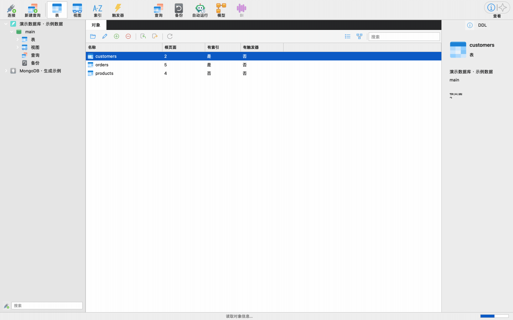

# OpenNavicat

目标是 **1:1 还原本机 Navicat 的界面和完整数据库工具功能**，运行环境为
**Windows、Linux、macOS**。排除产品账号、产品登录、订阅、激活及云账号协作；
数据库认证、数据库用户/权限和云数据库连接仍属于完整工具范围。使用
Python + Qt Widgets（PySide6），数据库连接、SQL 和结果均在本机处理。
项目从本机 Navicat Premium 的功能资源调查开始，以独立实现逐步覆盖完整的
数据库管理工作流。

下面是一段 OpenNavicat 实际运行演示：浏览示例表、编写并执行查询、查看结果、编辑表结构、
检查 SQL 预览，再查看 MongoDB 文档网格、精确 BSON 类型树、GridFS 图像预览、JavaScript 查询与索引设计。
连接名、客户、邮箱、日期、订单、商品、BSON、SQL 和图像均由隔离演示工作区生成，
不读取本机真实连接或业务数据库。单段 GIF 对应 **0.8.1 候选源码**的实际 Qt 界面，约 30 秒；
验证范围见 [0.8 候选记录](docs/validation-0.8.md)，下方仍提供已发布版本的安装包。



**0.8.1 候选已集成** Linux 历史连接发现、MongoDB 六页索引设计器和原生 JavaScript 查询。
0.8.0 的正式 Windows 字体门禁未通过，未发布 Release；本候选已修正并通过六平台字体专项，继续执行完整安装预检。
既有查询保留原执行语言，Linux 导入候选需要复核。
开发中的范围及限制见 [候选验证记录](docs/validation-0.8.md)。

最新可用里程碑 **[v0.7.1](https://github.com/shubolab/opennavicat/releases/tag/v0.7.1)**
已于 2026-11-11（北京时间）发布为早期预发行版本，提供三个操作系统、两种架构的六份安装包。
现有 **SQLite、PostgreSQL、MySQL、MariaDB、SQL Server、Redis、MongoDB** 七种核心驱动，
使用隔离数据库进行了真实协议、读写及界面集成验证。本版加入 MongoDB 单当前文档 BSON 树与记录导航、
GridFS 下方预览/进度、Windows 历史连接候选发现、配置/分组重载保护，并修复原生大字体端口裁字。
保留 MongoDB 原生命令、新版连接管理器、SQLite 独立索引/触发器设计及 macOS 历史连接自动加载、分组和去重。
完整 Navicat Premium 能力和 1:1 界面仍在持续实现中，
详细范围见 [功能路线图](docs/roadmap.md) 和 [0.7 验证记录](docs/validation-0.7.md)。

| 安装包 | amd64 / Intel、x64 | arm64 / Apple Silicon、Windows ARM |
| --- | --- | --- |
| macOS | [DMG](https://github.com/shubolab/opennavicat/releases/download/v0.7.1/OpenNavicat-0.7.1-macos-amd64.dmg) | [DMG](https://github.com/shubolab/opennavicat/releases/download/v0.7.1/OpenNavicat-0.7.1-macos-arm64.dmg) |
| Windows | [Setup EXE](https://github.com/shubolab/opennavicat/releases/download/v0.7.1/OpenNavicat-0.7.1-windows-amd64-setup.exe) | [Setup EXE](https://github.com/shubolab/opennavicat/releases/download/v0.7.1/OpenNavicat-0.7.1-windows-arm64-setup.exe) |
| Linux（Debian/Ubuntu） | [DEB](https://github.com/shubolab/opennavicat/releases/download/v0.7.1/OpenNavicat-0.7.1-linux-amd64.deb) | [DEB](https://github.com/shubolab/opennavicat/releases/download/v0.7.1/OpenNavicat-0.7.1-linux-arm64.deb) |

[SHA256SUMS](https://github.com/shubolab/opennavicat/releases/download/v0.7.1/SHA256SUMS)
和 [构建与安装验证清单](https://github.com/shubolab/opennavicat/releases/download/v0.7.1/build-manifests.json)
随版本发布。当前安装包没有发布者签名或 Apple 公证；Windows ARM64 安装引导器使用 x86，
安装后的应用、Python、Qt 及原生库为 ARM64。实际系统验证范围和功能边界见
[0.7 验证记录](docs/validation-0.7.md)。本版六个原生 CI 目标均实际完成测试、安装、运行和卸载，
公开的六份安装包也已匿名下载并核对摘要。Linux DEB 基于 Ubuntu 24.04，要求 glibc 2.39 或更新版本，
通过包管理器安装声明的 Qt 图形库及 Noto CJK 字体。
0.5 公开版本另完成 macOS ARM64、干净 Ubuntu ARM64 XCB 及 Windows AMD64 RDP 的 6×4 示例查询，
并在 Windows 实际打开 SQL Server/Redis 的连接设置；该次远程桌面没有连接真实 SQL Server/Redis 服务。
0.7.1 公开 macOS ARM64 安装包补充完成两次普通启动的历史加载、分组、去重和不自动连接检查。
Windows 候选需要复核认证与安全设置；原版 Windows 18 来源格式和 Linux 18 原生资料完整迁移仍待验收。
用户现场 Windows/WSL GUI 按要求延期，Dell 现场保留，托管 CI 的结果与该现场验收分开记录。
0.7.0 门禁发现原生大字体问题，未发布 Release；原标签和失败证据保留，0.7.1 以新标签通过全部门禁。

首个可用版本交付后曾按要求暂停。用户更新本机 Navicat 后已于 2026-11-10 明确恢复；
当前参考为 **Navicat Premium 18.0.5 build 321**，已重新实际打开并验证新建表、修改表、
SQL 预览、查询和多结果工作流。继续原定完整功能和 1:1 UI 目标，
旧 16.1.1 记录保留为历史证据。新版运行观察见
[18 版实际界面与行为记录](docs/ui-reference-18-observations.md)。

0.1 的自定义界面没有满足还原要求。0.2 开始实际打开参考应用，以同一个本地样例库
观察并重建主工具栏、分类导航、对象列表、信息面板、查询/结果区和连接对话框。
已实现的局部工作流不等于完整还原；[完整对齐矩阵](docs/parity-matrix.md) 分开记录
UI、工具能力和平台验收，所有未通过的门禁都保留在目标内。

## 运行

需要 Python 3.11 或更新版本；开发与打包建议使用 Python 3.13。

macOS / Linux：

```bash
python3 -m venv .venv
.venv/bin/python -m pip install -e '.[dev]'
.venv/bin/python -m opennavicat
```

Windows PowerShell：

```powershell
py -3.13 -m venv .venv
.venv\Scripts\python.exe -m pip install -e ".[dev]"
.venv\Scripts\python.exe -m opennavicat
```

安装后也可使用 `opennavicat` 命令。`scripts/run.sh` 与 `scripts/run.ps1`
提供快捷启动；首次运行且虚拟环境不存在时会创建环境并安装项目依赖。
项目提供公共 PyPI 依赖锁文件：安装 uv 后可用 `uv sync --frozen --extra dev`，
再用 `uv run opennavicat` 启动。当前 Python / Qt 版本的系统要求仍适用。

Linux 的桌面运行需要系统图形环境和 Qt 运行库。Ubuntu 24.04 示例：

```bash
sudo apt-get install libegl1 libopengl0 libxcb-cursor0 libxkbcommon-x11-0 libglib2.0-0t64 fonts-noto-cjk
```

## 工作流

0.2 默认跟随系统明暗主题。`--theme dark` / `--theme light` 可固定主题用于对照；
左侧搜索移至底部，数据库下按表/视图/查询/备份分组，中间“对象”页显示真实对象元数据，
右侧信息面板由“查看”开关控制。SQLite “有索引”列按独立索引计算，不把 rowid 主键
误当作独立索引。查询页使用消息/摘要/结果切换，连接窗口提供独立的异步测试连接。

实际参考步骤和当前渲染边界见 [原版界面观察](docs/ui-reference-observations.md)。
Linux 中文渲染使用系统 CJK 字体；构建环境提供 Noto Sans CJK，应用没有捆绑整套字体。

0.3 新增 PostgreSQL、MySQL、MariaDB 的 SSH 密码/私钥/组合身份验证、主机密钥确认、
压缩和实际 TCP 转发；TLS 支持自定义 CA、客户端证书/密钥、密钥口令、CRL 及模式选择。
SSH 转发后仍校验数据库原始主机名。首次未知 SSH 主机需要核对指纹；密钥变化拒绝连接。
这些连接能力与完整 Navicat 工具/UI 对齐是分别跟踪的验收范围。

- 从新连接管理器选择 SQLite、PostgreSQL、MySQL、MariaDB、SQL Server、Redis 或 MongoDB，
  填写并保存配置后在连接树打开连接。九种数据库族入口均可见，Oracle、Snowflake 仍显示待实现；
  供应商别名交给普通驱动设置，不表示专属认证已经实现。
- 在连接树浏览数据库、schema、表和视图；打开表查看分页数据与结构信息。
- 新建 SQL 标签页，打开/保存 SQL 文件，执行语句或选区，查看独立结果集。
- 对有主键的表编辑记录、插入和删除，使用提交/回滚控制事务。
- SQLite 使用独立表设计标签创建或修改表，编辑字段、索引、外键、唯一键、触发器和选项，
  查看更改/DDL，再通过保存确认执行。PostgreSQL、MySQL、MariaDB、SQL Server 目前提供只读结构和 SQL 建表入口。
- 从 SQLite 的独立索引或触发器列表进入设计器，检查 SQL 预览后保存；保存时检查快照、依赖与待提交编辑，
  不安全或无法完整解析的对象明确保持只读。
- Redis 使用原生命令查询页和键数据工作区，读取或编辑 string/hash/list/set/zset/stream，
  查看或修改 TTL、重命名和删除键。当前支持 standalone；集群、哨兵和 PubSub 尚未实现。
- MongoDB standalone 提供精确 BSON 网格、树和 Canonical Extended JSON 文档编辑、冲突保护。
  0.8 源码的新建查询使用原生 JavaScript，支持变量、函数、循环和已实现的 BSON/数据库接口；
  既有查询保留原来的命令语义。GridFS 支持后台传输、筛选、分页及有界图像预览。
  本版提供单当前文档树及记录导航；树字段双击使用 Extended JSON 编辑器。
  索引支持六页设计和保存/删除；将“执行脚本（集合 UUID）”复制到默认 JS 查询可运行，辅助脚本用于 mongosh。
  原版行内编辑/类型 popup、完整参考 JS 全局/API、聚合构建器及更多拓扑仍在对齐。
- 导入 CSV / JSON 数据，导出当前结果；收藏查询并通过历史记录重新打开 SQL。
- 使用 SQLite 备份保留可独立打开的数据库快照。
- 点击 **模型** 从当前 schema 的真实表和外键生成关系图；可拖动、缩放，
  导出 PNG / SVG。关系图反映读取时的结构，调整布局不会修改数据库。
- 打开源表后使用 **其它 → 数据同步**，选择已连接的目标表，
  预览插入、修改和目标独有记录，再明确应用。目标独有记录默认保留；
  删除需要单独勾选。修改和删除检查原始行值以防覆盖并发更新，整批写入按一个事务提交。

界面提供可直接打开的示例 SQLite 工作区，便于在无需数据库服务的情况下体验。
结果集有行数上限，导出的内容以实际已加载的结果为准。表数据写入依赖主键定位；
无主键和视图应通过 SQL 显式处理。连接的实际权限由数据库服务器管理。
DDL 的完整程度取决于数据库方言；PostgreSQL 表定义由元数据重建，未包含所有者、
权限、存储参数和独立索引。远程驱动的索引/外键面板目前可查看元数据，结构修改通过 SQL 执行。
SQLite 表设计器保留未编辑的原始约束、CHECK、索引和触发器；复杂表达式/部分索引只读保留，
无法安全解释的结构拒绝修改。保存期间检查 schema 是否变化，重建失败整体回滚。
原版某些修改会留下旧表副本；当前实现采用原地 ALTER 或事务重建，这项行为差异仍在对齐清单中。
数据比较当前要求相同列名和主键，每表最多 10,000 行，超过上限直接拒绝比较；
MySQL/MariaDB 目标必须是 InnoDB。它同步预览中列出的行，不锁定源表，
也不会覆盖预览后被修改的无差异行。结构变化需要重新比较。

## Navicat 历史连接

0.5.0 默认在普通启动时自动发现本机 Navicat 的历史连接，显示在“Navicat 连接”分组中。
macOS Navicat 18 的实际连接及分组格式已验证，保留分组关系，重复加载按来源身份去重；
你在 OpenNavicat 里手工创建或修改的配置会保留。已打开的会话继续使用原配置，来源更新在断开后生效。
工具菜单提供“从 Navicat 重新加载连接”和自动加载开关。演示、smoke 和截图模式不读取历史连接。
0.7.1 公开 macOS ARM64 安装包已完成两次普通启动，核验完整历史源加载、分组、无重复项，
四类秘密字段均为空，且没有自动建立数据库网络连接。

加载只读取来源文件，不修改 Navicat，也不会自动连接数据库或读取已保存密码。
原版保存的密码不会迁移：首次打开连接时需重新填写数据库密码、SSH 密码、私钥口令或客户端密钥口令等所需凭据；
可以使用 OpenNavicat 自己的系统钥匙串保存选项。
无法准确映射的认证或安全设置会保留为待复核，尚未实现的驱动也保留可见，不能静默换成其它连接类型。
原生 UUID 为空的来源按名称空间、数据库类型、位置和名称生成稳定身份；此时原版重命名会成为新来源项。
来源删除不会删除本地连接。0.7.1 接入 Windows 当前用户注册表的元数据候选发现，
只读明确白名单的非秘密字段，保留可见驱动和已知分组；未知认证、TLS/SSH 与格式均保持待复核，
确认设置前阻止连接。重复加载保护本地修改，读取不完整时保留已有配置和分组。
Linux JSON 仅支持已识别格式；Windows 18 实际原生格式和 Linux 完整迁移尚未完成来源与原生界面验收。
范围见 [Windows 元数据发现](docs/windows-navicat-discovery.md)、[0.7 验证记录](docs/validation-0.7.md)及 [0.5 验证记录](docs/validation-0.5.md)。

## 数据和密码

连接配置与查询收藏保存到当前操作系统的 Qt 应用数据目录，文件为
`workspace.json`；查询历史存于同目录的 `history.sqlite3`。
可通过 `OPENNAVICAT_DATA_DIR` 指向隔离目录，用于开发、测试或便携式数据存储。

密码默认只在本次进程中保留。启用保存密码后使用操作系统 keyring/keychain；
如果系统密钥服务不可用，不会自动退回明文文件。配置文件不保存数据库密码、SSH 密码、
SSH 私钥口令和 TLS 客户端密钥口令；各项有独立的保存选择。
SQL 历史和编辑器草稿会保留用户输入的 SQL；其中可能包含 SQL 字面量和业务数据。

CSV 使用 UTF-8 BOM，首行为字段名；`\N` 表示数据库 NULL，普通反斜杠使用
`\\` 转义。JSON 导出采用 `{"columns": [...], "rows": [...]}`，保留 SQL
重复列名和行顺序；BLOB 使用 `{"$binary": "base64..."}` 表示。导入要求唯一、
非空字段名和一致的行宽，也接受字段集合一致的 JSON 对象数组。CSV 值以文本
传入驱动，由目标列类型转换；需要精确保留二进制值时使用 JSON。

## 测试与构建

```bash
QT_QPA_PLATFORM=offscreen .venv/bin/python -m pytest -q
.venv/bin/python scripts/build.py --clean --archive
```

Windows 的测试可先执行 `$env:QT_QPA_PLATFORM = 'offscreen'`，再使用虚拟环境的
Python 执行同一命令。

PyInstaller 为**当前操作系统和架构**生成原生程序：

| 构建主机 | 可运行输出 | 分发文件 |
| --- | --- | --- |
| macOS | `dist/OpenNavicat.app` | `artifacts/OpenNavicat-<version>-darwin-<arch>.zip` |
| Windows | `dist/OpenNavicat/OpenNavicat.exe` | `artifacts/OpenNavicat-<version>-windows-<arch>.zip` |
| Linux | `dist/OpenNavicat/OpenNavicat` | `artifacts/OpenNavicat-<version>-linux-<arch>.zip` |

ZIP 用于构建调试。正式里程碑发布使用安装包：macOS `.dmg`、Windows `-setup.exe`、
Linux `.deb`，每个平台分别提供 amd64 和 arm64。安装包包含 Python、Qt、驱动和共享库。
当前构建不配置发布签名或公证。详细规则见 [发布约定](docs/release-policy.md)。

`.github/workflows/build.yml` 定义六个原生 OS/架构主机的测试、打包、安装、运行和卸载检查，
只有六份安装包和安全连接检查均通过时才发布 tag 对应的 Release。
**存在 CI 配置不代表这些平台已执行或通过验收**；
实际状态应以对应运行记录和目标机器上的启动结果为准。运行环境也受该版本 Qt
与驱动 wheel 的平台要求约束。

源码和打包程序均提供隔离的端到端 smoke：

```bash
.venv/bin/python -m opennavicat --smoke-test
# macOS 打包后
dist/OpenNavicat.app/Contents/MacOS/OpenNavicat --smoke-test
```

该命令创建临时示例数据库，通过真实后台连接运行查询，验证结果后退出。
它也实际加载 PostgreSQL、MySQL、SQL Server、Redis、MongoDB 和 SSH/加密依赖，构造新增驱动适配器、
SQL Server/MongoDB TLS context 并检查原生 BSON 和加密 cipher；这些探针不会连接外部数据库。`--smoke-report <path>` 保存运行时版本、
架构与驱动报告。Windows arm64 使用原生 libpq（通过 `scripts/build-libpq-windows.ps1`
构建）与 psycopg 的 Python 绑定，运行源码时需把 libpq DLL 目录放入 PATH 并设置
`OPENNAVICAT_LIBPQ_DIR`；该脚本也配置加密库的 OpenSSL 源码构建路径。安装包直接包含运行库。
`--demo` 则打开可交互的持久示例工作区。具体环境、测试数量、已构建产物及尚未验收项
见 [0.7 验证记录](docs/validation-0.7.md)（[0.6](docs/validation-0.6.md)、[0.5](docs/validation-0.5.md)、[0.4](docs/validation-0.4.md)、[0.3](docs/validation-0.3.md)、[0.2](docs/validation-0.2.md)、[0.1 历史记录](docs/validation.md)）。Linux 容器构建可执行 `scripts/build-linux.sh`，
它在独立环境中测试、打包并运行产物，输出到 `artifacts/linux/`。

README 演示可用 `.venv/bin/python scripts/record-demo.py --include-mongodb --output docs/assets/opennavicat-demo.gif`
重新录制，需要本机已有 ffmpeg 和可用 Docker；脚本只创建本次独有的 loopback MongoDB 服务，结束后核验并清理。
省略 `--include-mongodb` 可只录制 SQLite 六段。录制前后均不访问用户 Navicat 配置或系统钥匙串。
脚本直接记录运行中 Qt 窗口的连续帧，临时样例库与 PNG 自动清理，仅输出一段 GIF 和不含个人路径的记录。

## 参考、实现与许可证

[Navicat 调查报告](docs/navicat-reference.md) 区分资源中的功能声明、重建设计和
尚未验证的行为。当前参考对象是本机 Navicat Premium 18.0.5 build 321；当前实现的行为
由 OpenNavicat 源码和测试决定。原始 REA 证据是本机诊断文件，已从源码分发忽略。

OpenNavicat 自有代码使用 [MIT License](LICENSE)。依赖分别使用其自身许可证，
见 [第三方声明](THIRD_PARTY_NOTICES.md)。项目与 Navicat / PremiumSoft 无隶属关系；
未将其程序代码、图标或美术资源作为应用资产使用。
