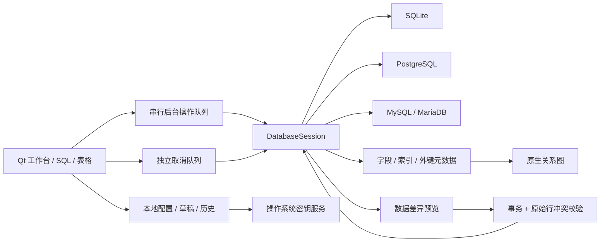

# 实现结构

OpenNavicat 使用 Qt 6 Widgets 原生桌面控件，Python 负责工作流编排和驱动适配。
应用不需要浏览器、Web 服务或 Navicat 安装。SQLite 使用 Python 内置驱动，
PostgreSQL 使用 psycopg 3，MySQL/MariaDB 使用 PyMySQL。

- `__main__.py` 初始化平台应用、样式、工作区锁及独立的 smoke 生命周期。
- `ui/window.py` 连接树、SQL/表标签、动作状态、后台任务和事务交互。
- `ui/editor.py` SQL 高亮、行号、选区、查找和已有对象名称补全。
- `ui/grid.py` 数据模型保留原始值，草稿变更与真实写入分开；生成列保持只读。
- `ui/dialogs.py` 原生连接表单、表设计 SQL 预览和带 NULL/default 区分的记录输入。
- `database.py` 方言引用、参数绑定、对象元数据、会话事务、取消及原子写入。
- `transport.py` 由会话拥有的 SSH 连接与 loopback TCP 转发；认证前验证主机密钥，失败和关闭均释放监听端口、channel 和线程。数据库原始主机名保留给 TLS 校验。
- `compare.py` 有界差异计划，绑定目标配置和表结构；应用时复查绑定与行冲突。
- `ui/diagram.py` Qt 图形场景绘制真实表与外键，无数据库写入。
- `storage.py` 原子配置文件、SQLite 查询历史及 OS keyring；密码不会写入配置。
- `transfer.py` CSV / JSON 交换，保留 NULL、重复 SQL 列名及 JSON 二进制表示。

所有 Qt 控件访问在 GUI 线程，数据库操作在串行后台队列，保证共享连接的事务
不会被两个界面操作并发使用。取消走独立工作队列，可中断正在执行的查询。
表浏览、行编辑、导入和比较不拼接用户值；SQL 编辑器按用户输入执行原始 SQL。

SSH 和数据库认证分开处理，密码、SSH 密码、SSH 私钥口令和 TLS 密钥口令分别选择
是否保存。后台出现未知 SSH 主机密钥时，会先结束并关闭本次连接，再在 GUI 线程请求
核对实际指纹；明确接受后把公开密钥固定到该连接资料，并重新执行连接。密钥不匹配
没有自动接受路径。首次数据库认证先尝试配置值，避免对有效的空密码或客户端证书认证
预先弹出无关密码框。需要重新输入的秘密仅在对应认证实际拒绝后询问。

PostgreSQL 使用 libpq 17+ 的安全非阻塞取消，避免旧 PQcancel 在进程内 SSH 转发时
阻塞并占用 GIL。MySQL/MariaDB 的独立取消连接复用相同 SSH/TLS 配置。连接及握手
超时与查询读取超时分开，TLS 客户端私钥加载禁止终端交互提示。

返回行数限制是结果展示约束。PostgreSQL 普通游标底层可能缓存服务器完整结果，
因此不能把它描述为服务端执行工作量或整个进程内存的硬上限。

当前完整功能范围、后续能力与平台验收分别记录在 `roadmap.md` 和 `validation.md`。
本机 Navicat 的静态资源调查只作为产品需求证据，不作为本应用运行依赖或行为证明。
